# AWS Cloud Infrastructure Monitoring & Alerting

## Project Overview
This project demonstrates proactive AWS infrastructure monitoring, alerting, troubleshooting, and incident response for an Amazon EC2 workload.

## Architecture
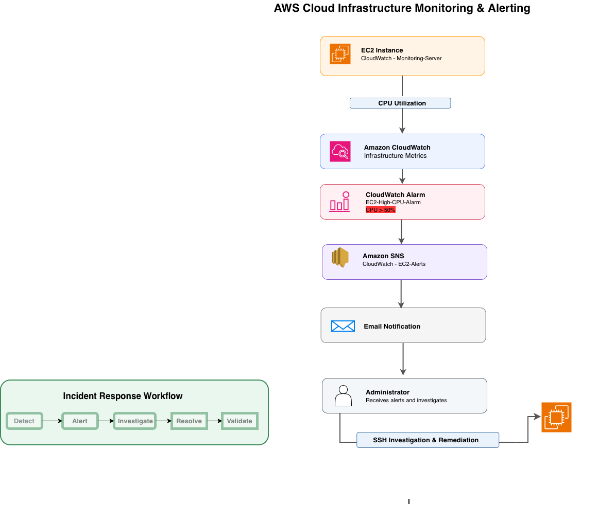

## Monitoring Workflow
Detect → Alert → Investigate → Resolve → Validate

## AWS Services Used
- Amazon EC2
- Amazon CloudWatch
- CloudWatch Alarms
- Amazon SNS

## Technologies Used
- Amazon Linux 2023
- Linux
- SSH
- CloudWatch Metrics
- Email Notifications
- GitHub
- draw.io

## Implementation

### EC2 Monitoring
Amazon CloudWatch was configured to monitor CPU utilization for the EC2 workload.

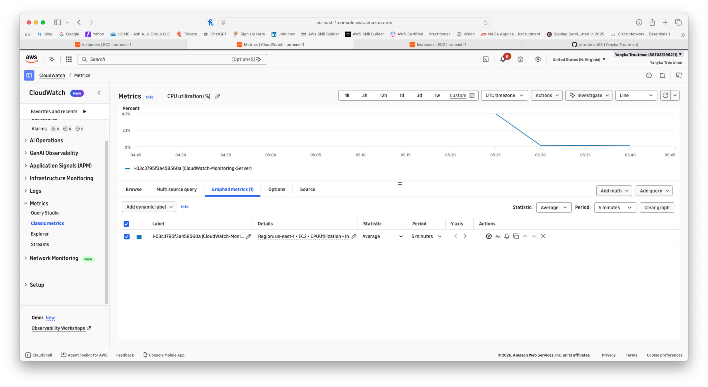

### SNS Notifications
Amazon SNS was configured to deliver infrastructure alerts through email.

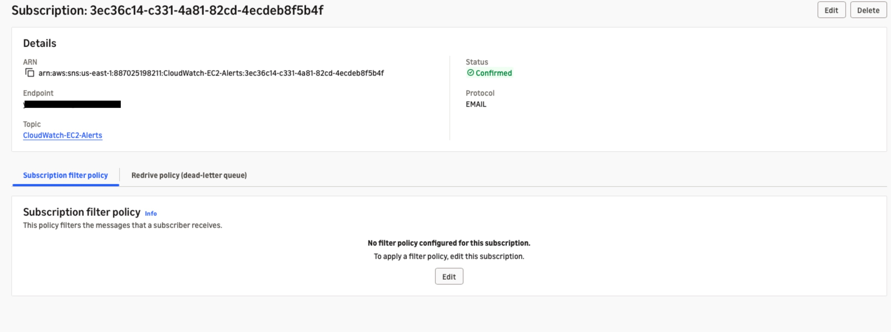

### CloudWatch Alarm
A CloudWatch alarm was configured to trigger when average CPU utilization exceeded 50%.

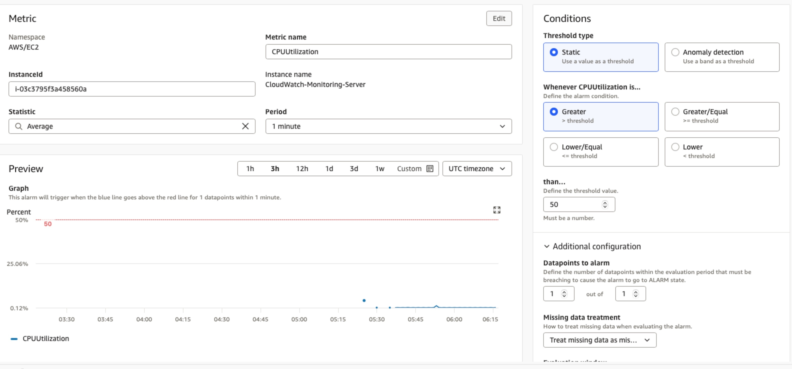

### Performance Incident Simulation
A CPU-intensive workload was intentionally generated on the EC2 instance.

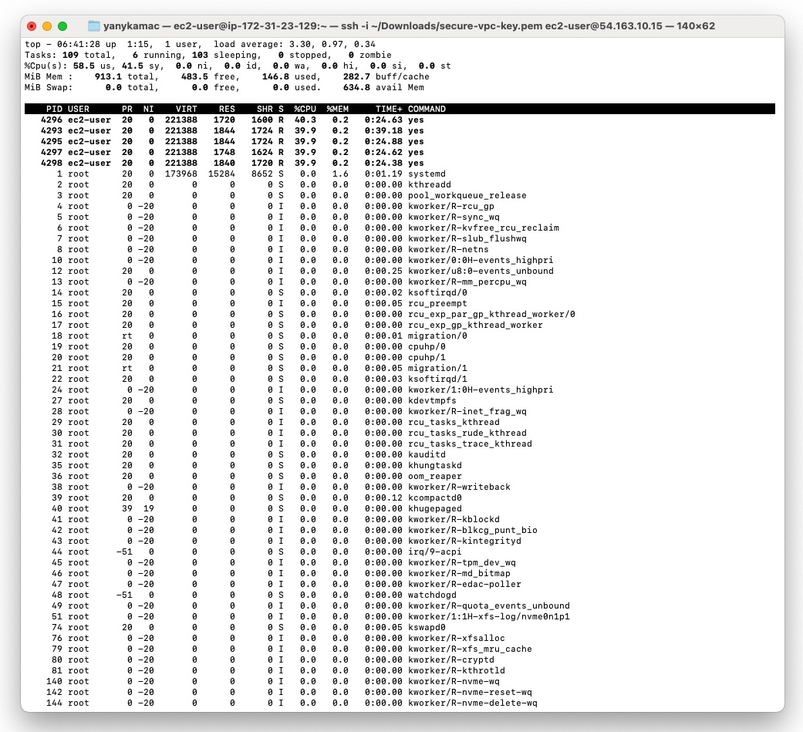

### Alarm Detection
CloudWatch detected the threshold breach and transitioned the alarm to ALARM.

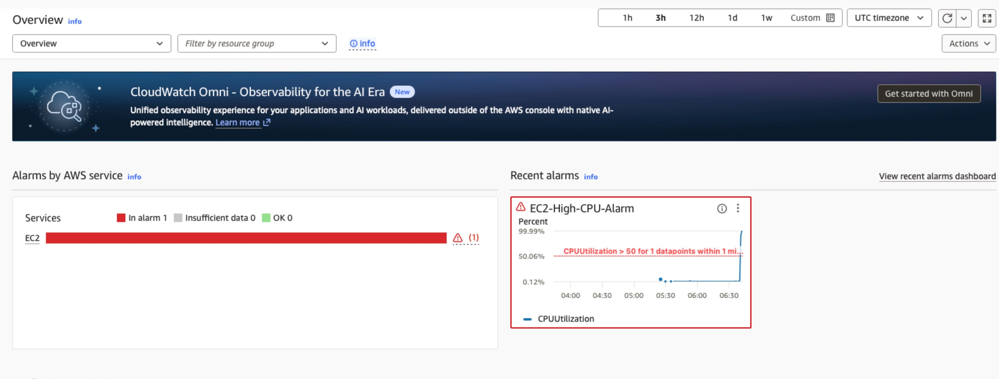

### Automated Notification
Amazon SNS delivered an automated email notification.

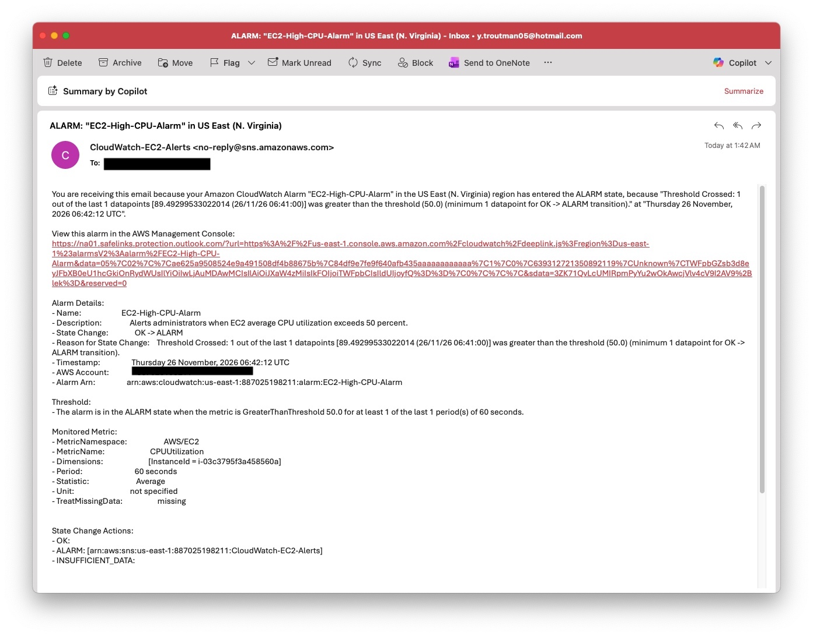

### Incident Investigation
Linux monitoring tools were used to identify the CPU-intensive processes responsible for the issue.

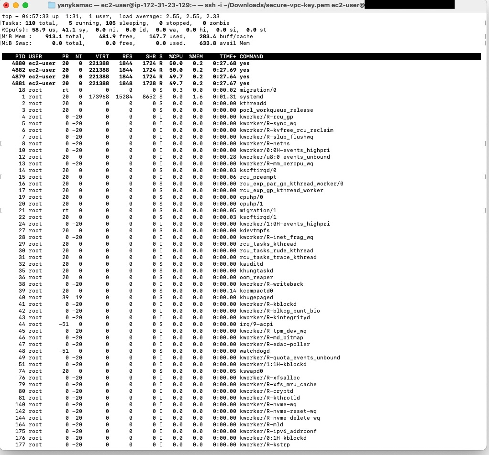

### Remediation
The offending processes were stopped and CPU utilization returned to normal.

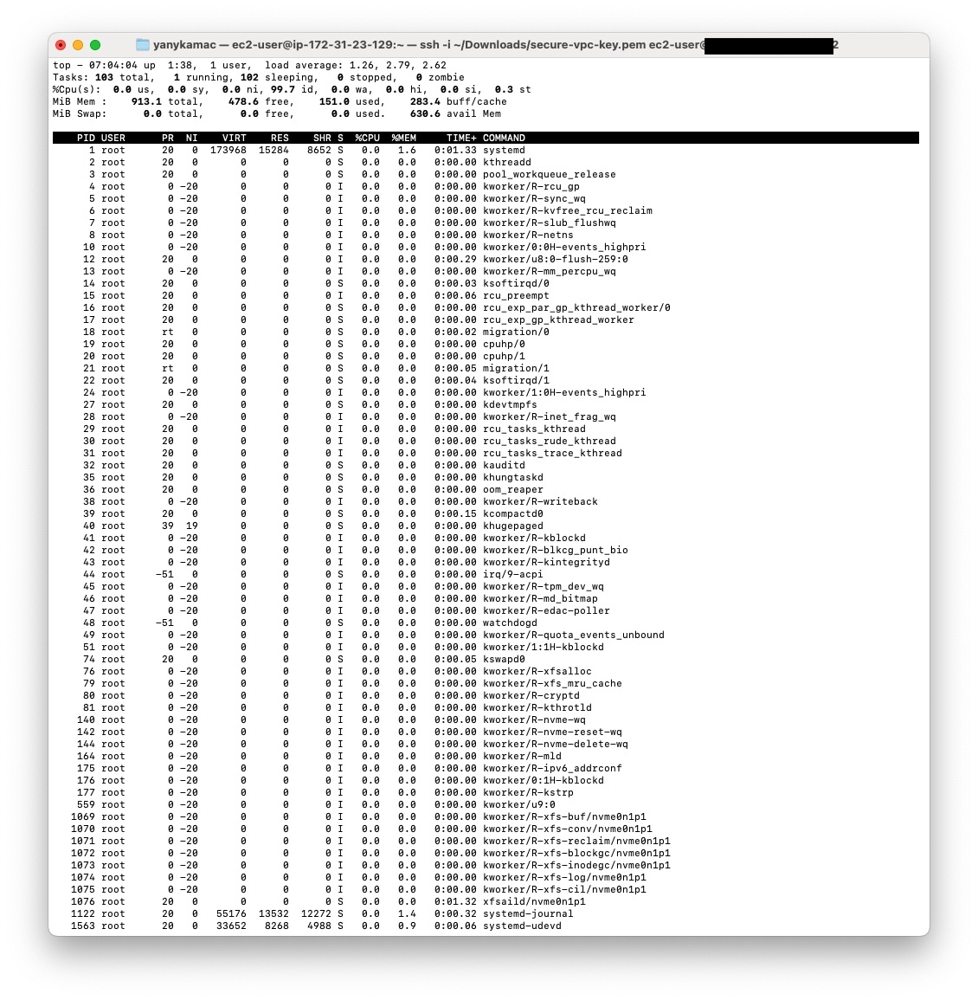

### Recovery Validation
CloudWatch returned the alarm state to OK.

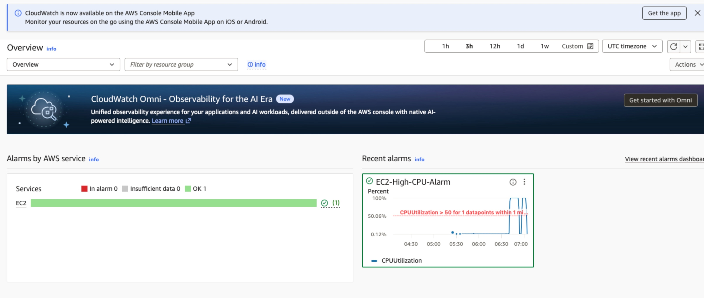

### Operations Dashboard
A CloudWatch dashboard was created to provide centralized infrastructure visibility.

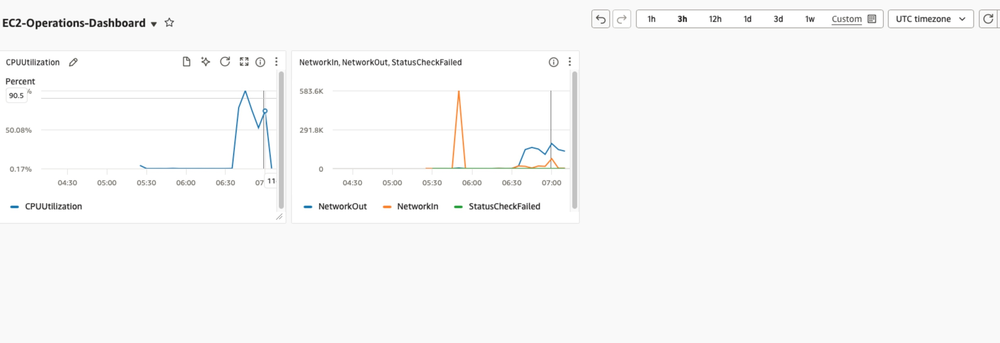

## Incident Documentation
[View Incident Report](incident-report.md)

## Key Takeaways
- AWS infrastructure monitoring
- CloudWatch metrics
- CloudWatch alarms
- SNS notifications
- Linux troubleshooting
- Incident investigation
- Remediation
- Recovery validation
- Operational documentation

## Business Value
Proactive monitoring helps teams detect infrastructure issues quickly, automate notifications, reduce response time, and validate recovery after remediation.

## Skills Demonstrated
`AWS` `EC2` `CloudWatch` `SNS` `Linux` `Monitoring` `Alerting` `Troubleshooting` `Incident Response` `Cloud Operations`
